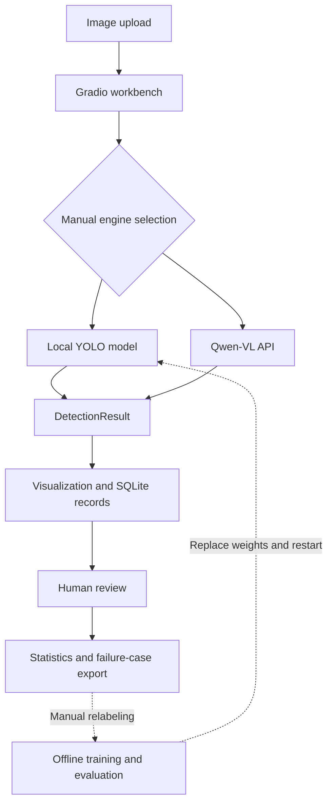

<div align="center">

# Steel Defect Inspection

### A human-in-the-loop visual inspection workbench

**Detect defects. Review predictions. Feed failure cases back into training.**

[](requirements.txt)
[](detection_engine.py)
[](detection_engine.py)
[](https://github.com/SimonLecake/steel-defect-inspection/actions/workflows/checks.yml)

[简体中文](README.md) · **English** · [Architecture](docs/architecture.md) · [Validation](docs/validation.md)

</div>


## Recorded demo

**03:10** · Play inline or use the player's fullscreen control.

Upload an image, try YOLO and VLM detection, review results, inspect records, export error cases and run batch predictions.

https://github.com/user-attachments/assets/d346e19f-a398-43ef-a979-c9453fc4cfad

**Approximate chapters:** `00:00` Image and YOLO detection · `00:58` VLM detection · `01:20` Human review · `01:35` Records · `02:00` Error-case export · `02:20` Batch prediction

<details>
<summary>Expand a screenshot from the recording</summary>


Captured from the author-provided recording. The application interface is in Chinese.

</details>

The recording demonstrates the workflow and individual results, not overall detection accuracy. Human review can still identify false positives or missed defects.

## Overview

A Python application for steel surface defect inspection, combining two selectable approaches: a locally trained **YOLO detector** and a **Qwen-VL vision-language model** accessed through an OpenAI-compatible API.

The workbench connects image inference to persistent inspection records, manual review, summary statistics, and failure-case export. It demonstrates the workflow around a model: how predictions are inspected, mistakes are recorded, and examples are collected for the next training cycle.

This is a learning and engineering portfolio project organized from AI inspection course/practice materials. It is an engineering prototype. The engines are selected manually, and annotation correction and retraining are human-managed steps. See [provenance](docs/provenance.md).

## Highlights

| Capability | Implementation | Purpose |
|---|---|---|
| Two inference routes | Local YOLOv12n / remote or self-hosted VLM API | Explore task-specific detection and prompt-based validation |
| Shared result contract | `DetectionBox` and `DetectionResult` | Reuse visualization and persistence across engines |
| Human review | Correct / false detection / missed detection, with notes | Capture actionable feedback |
| Traceable records | SQLite and local image paths | Inspect prior predictions and review decisions |
| Data feedback | Export images and review CSV files | Prepare cases for annotation correction and retraining |
| Experiment tools | Label conversion, EDA, augmentation, training and batch inference | Cover the path from dataset preparation to application |

## Defect classes

`crazing` · `inclusion` · `pitted_surface` · `scratches` · `patches` · `rolled-in_scale`

Class IDs are 0–5 in this order. Model weights, dataset labels, and application configuration must use the same mapping.

## Architecture



The application is a modular monolith: Gradio callbacks invoke inference, database, and export functions directly. There is no automatic ensemble or routing between the two engines.

## Quick start

Python 3.11 is recommended. Windows PowerShell:

```powershell
git clone https://github.com/SimonLecake/steel-defect-inspection.git
cd steel-defect-inspection
python -m venv .venv
.\.venv\Scripts\python.exe -m pip install -r requirements.txt
.\.venv\Scripts\python.exe app.py
```

Open **http://127.0.0.1:7860**. On Linux/macOS use `.venv/bin/python` instead. Optional augmentation dependencies are listed in `requirements-training.txt`.

The repository includes source and configuration, **not datasets or checkpoints**. The UI can start without them; inference requires one of the following routes.

### Local YOLO

Place a compatible, trained six-class checkpoint at `models/best.pt`, upload an image, select **YOLO**, and run detection. A generic COCO checkpoint is not a steel-defect model. See [model setup](models/README.md). Restart the app after replacing a loaded checkpoint.

### Qwen-VL

Enter your API settings in the UI or set environment variables before starting:

```powershell
$env:DASHSCOPE_API_KEY="<your-api-key>"
$env:VLM_BASE_URL="https://dashscope.aliyuncs.com/compatible-mode/v1"
$env:VLM_MODEL_NAME="qwen3-vl-plus"
.\.venv\Scripts\python.exe app.py
```

Select **VLM** and upload an image. No local checkpoint is needed. Images are sent to the configured service; charges depend on the provider. `.env.example` is a reference only and is not loaded automatically.

### Review and export

The five tabs cover detection, records, statistics, export, and competition submission. Review a prediction, mark it correct / wrong / missed, and export problematic examples for annotation correction. Local records, uploads, and exports are excluded from Git.

## Training and batch inference

Follow the [dataset preparation guide](yolo-cases/steel_data/README.md), then run:

```powershell
# CPU smoke run; requires prepared data and performs prediction afterwards
.\.venv\Scripts\python.exe train_and_predict.py --device cpu --epochs 1

# Train from the YAML architecture on a configured GPU environment
.\.venv\Scripts\python.exe train_and_predict.py --device 0 --epochs 100 --batch 16 --enhanced

# One CSV row per detection; input image stems must be numeric
.\.venv\Scripts\python.exe generate_submission.py --model models/best.pt --conf 0.25
```

`train_and_predict.py` uses `pretrained=False`. The separate `train_yolo_enhanced.py` script contains pretrained-model experiments. GPU execution requires an appropriate PyTorch/CUDA installation.

## Evaluation and current limitations

- This release emphasizes workflow and implementation. It does not claim a reproducible production benchmark.
- Original notes reported `mAP50 = 0.894`; the complete matching run artifacts are not included, so this is not presented as a verified benchmark.
- The original example validation split had only 14 images. A larger independent evaluation set is required.
- Review accuracy means the fraction of reviewed records marked correct. It is not mAP, object-level precision/recall, or a production escape rate.
- VLM confidence is currently a placeholder `1.0`, not a calibrated probability. API and parsing failures need stronger separation from empty detections.
- Relabeling and retraining are manual. Camera integration, hardware control, user isolation, model versioning, and production monitoring are future work.

See [validation details](docs/validation.md). Automated checks exercise parsing, persistence, and export without cloud calls; they do not measure model quality.

## Source map

| File | Responsibility |
|---|---|
| `app.py` | Gradio UI and workflow orchestration |
| `detection_engine.py` | YOLO/VLM adapters and shared result types |
| `db_manager.py` | SQLite persistence, review and statistics |
| `data_export.py` | Failure-case and retraining-material export |
| `train_and_predict.py` | Training, inference and submission generation |
| `train_yolo_enhanced.py` | Augmentation and pretrained-model experiments |
| `generate_submission.py` | Batch prediction CSV |
| `eda_analysis.py`, `augmentation_demo.py` | Dataset and augmentation exploration |
| `tests/` | Offline regression checks |

## Roadmap

- [ ] Representative evaluation data and per-class metrics.
- [ ] Explicit failure states and validated VLM responses.
- [ ] Reviewer, dataset and model version tracking.
- [ ] Configurable YOLO screening with VLM-assisted review.
- [ ] Camera inputs and application-specific quality decisions.

These are planned capabilities. For project origins, excluded materials, and licensing status, see [provenance](docs/provenance.md).
