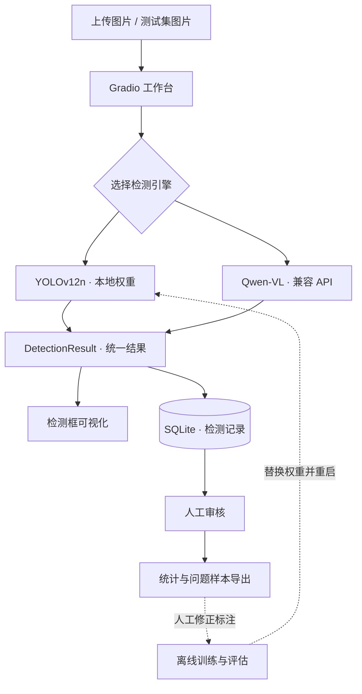

<div align="center">

# Steel Defect Inspection

### 钢铁表面缺陷 · AI 质检工作台

**从缺陷定位，到人工复核，再到训练数据回流。**

[](requirements.txt)
[](detection_engine.py)
[](detection_engine.py)
[](app.py)
[](https://github.com/SimonLecake/steel-defect-inspection/actions/workflows/checks.yml)

**简体中文** · [English](README.en.md) · [架构与设计](docs/architecture.md) · [验证说明](docs/validation.md)

</div>


## 实机演示

**03:10** · 可直接播放或全屏观看。

上传图片，分别体验 YOLO 与 VLM 检测，再完成人工审核、历史记录查询、问题样本导出和批量预测。

https://github.com/user-attachments/assets/d346e19f-a398-43ef-a979-c9453fc4cfad

**关键片段（约）:** `00:00` 图片与 YOLO 检测 · `00:58` VLM 检测 · `01:20` 人工审核 · `01:35` 历史记录 · `02:00` 问题样本导出 · `02:20` 批量预测

<details>
<summary>展开查看录屏截图</summary>


从作者提供的实际录屏中截取，保留应用画面。

</details>

录屏展示操作流程和个别样本结果，不代表整体检测准确率；人工审核仍可能标记误检或漏检。

## 项目简介

面向钢铁表面缺陷检测的计算机视觉应用，使用 **YOLO 专用目标检测模型**和 **Qwen-VL 视觉语言模型**两条技术路线，提供可交互的检测、记录、审核、统计与问题样本导出功能。

项目关注一个实际问题：**模型发现缺陷之后，如何让人确认结果、追溯问题，并把错误转化为下一轮改进的数据？**

这是基于 AI 质检实战材料整理的个人学习与工程实践作品，当前定位为可运行的工程原型。双引擎由用户手动选择，重标注与再训练由人工组织。项目背景与第三方资源说明见 [项目来源](docs/provenance.md)。

## 展示亮点

| 工程能力 | 具体实现 | 应用价值 |
|---|---|---|
| 双路线视觉检测 | 本地 YOLO 推理 / OpenAI 兼容接口调用 Qwen-VL | 支持固定缺陷检测与新场景快速验证 |
| 统一引擎接口 | `DetectionBox`、`DetectionResult` 数据契约 | 展示与存储复用同一套结果结构 |
| 人工参与决策 | 正确 / 误检 / 漏检标记，附审核备注 | 保留人工判断，积累可复盘的错误样本 |
| 结果可追溯 | SQLite 保存图片路径、预测、耗时和审核状态 | 支持历史查询与问题回查 |
| 数据回流 | 导出问题图片、CSV 与重训练说明 | 为修正标注和下一轮训练准备材料 |
| 完整实验流程 | 标注转换、EDA、数据增强、训练、批量预测 | 覆盖模型实验到应用交付的主要环节 |

## 支持的缺陷

| ID | 类别 | 中文 | 典型外观 |
|---|---|---|---|
| 0 | `crazing` | 龟裂 | 网状细小裂纹 |
| 1 | `inclusion` | 夹杂 | 表面杂质或异物 |
| 2 | `pitted_surface` | 点蚀 | 凹坑、麻点 |
| 3 | `scratches` | 划痕 | 线状刮痕 |
| 4 | `patches` | 斑块 | 不规则色斑 |
| 5 | `rolled-in_scale` | 氧化铁皮压入 | 氧化皮压入痕迹 |

## 系统架构



| YOLO 路线 | VLM 路线 |
|---|---|
| 使用标注数据训练六类缺陷检测模型 | 用图片与提示词调用视觉语言模型 |
| 返回类别、检测框与模型置信度 | 返回检测框与缺陷文字描述 |
| 推理在本地 CPU / GPU 执行 | 默认通过 DashScope，也可配置兼容服务 |
| 适合固定类别的专用检测实验 | 适合冷启动验证和辅助人工理解 |

VLM 的 `confidence` 当前为接口占位值 `1.0`，不能解释为“100% 可信”，也不能与 YOLO 置信度比较。系统尚未实现自动级联、模型投票或生产合格判定。

## 快速开始

### 1. 安装环境

建议 Python 3.11。以下命令适用于 Windows PowerShell：

```powershell
git clone https://github.com/SimonLecake/steel-defect-inspection.git
cd steel-defect-inspection
python -m venv .venv
.\.venv\Scripts\python.exe -m pip install -r requirements.txt
.\.venv\Scripts\python.exe app.py
```

打开 **http://127.0.0.1:7860**。Linux / macOS 可将解释器路径替换为 `.venv/bin/python`。训练与离线增强的可选依赖在 `requirements-training.txt`。

仓库提供源代码和配置，**不附带数据集与模型权重**。启动界面无需权重；执行检测前，按下面的任一路线准备资源。

### 2A. 使用 YOLO 本地检测

1. 准备类别顺序匹配本项目的已训练权重，放到 `models/best.pt`。
2. 在“缺陷检测”中上传图片，选择 **YOLO**，调整置信度阈值。
3. 点击“开始检测”，查看框选结果并提交人工审核。

通用 COCO 权重不能直接当作钢铁六类缺陷模型。权重要求见 [models/README.md](models/README.md)。首次检测会加载模型；替换权重后需重启程序。

### 2B. 使用 Qwen-VL 检测

在界面“VLM API 配置”中填写自己的服务参数，或在启动前设置环境变量：

```powershell
$env:DASHSCOPE_API_KEY="<your-api-key>"
$env:VLM_BASE_URL="https://dashscope.aliyuncs.com/compatible-mode/v1"
$env:VLM_MODEL_NAME="qwen3-vl-plus"
.\.venv\Scripts\python.exe app.py
```

选择 **VLM** 后上传图片并检测。这条路线无需本地权重。图片会发送到所配置的服务，调用成本取决于该服务。`.env.example` 仅是配置参考，程序不会自动读取 `.env` 文件。

### 3. 体验质检流程

**上传 → 检测 → 人工审核 → 查询记录 → 查看统计 → 导出问题样本。**

工作台包含“缺陷检测”“检测记录”“统计分析”“数据导出”“竞赛提交”五个标签页。记录自动写入本地 `inspection.db`，上传图片保存在 `temp_uploads/`，导出材料保存在 `exports/`；这些运行数据均被 Git 忽略。

## 训练与批量推理

先按照 [数据准备指南](yolo-cases/steel_data/README.md) 放置图片、YOLO 标签和互不重叠的数据划分，再运行：

```powershell
# CPU：一轮训练验证流程，同时执行后续预测；需要准备数据集
.\.venv\Scripts\python.exe train_and_predict.py --device cpu --epochs 1

# GPU：按 YAML 结构从头训练，启用增强策略
.\.venv\Scripts\python.exe train_and_predict.py --device 0 --epochs 100 --batch 16 --enhanced

# 使用已训练权重生成逐框 CSV；测试图片名需要为数字
.\.venv\Scripts\python.exe generate_submission.py --model models/best.pt --conf 0.25
```

`train_and_predict.py` 默认从 YAML 创建模型、`pretrained=False`；`train_yolo_enhanced.py` 提供预训练权重微调等独立实验入口。GPU 运行需配套可用的 PyTorch / CUDA 环境。

导出误检、漏检样本后，需要使用标注工具修正标签，合并训练数据，在独立验证集上评估新旧模型，再替换工作台权重。

## 效果与验证口径

当前公开版本侧重 **流程完整性与工程实现**，没有将未经复核的数字作为性能承诺。

- 原始资料记录过 `mAP50 = 0.894`；公开仓库没有包含该次实验完整的权重、配置与评估产物，因此不将它作为可复现基准。
- 原始数据划分中的验证集只有 14 张，后续应扩大并覆盖不同批次、材质和光照条件。
- 工作台“审核准确率”是已审核记录中标为正确的比例，不等于 mAP、逐框 precision / recall 或产线漏检率。
- 自动检查覆盖坐标解析、记录存取和问题样本导出；不调用付费 API，不替代模型质量评估。

验证范围、已知限制与复现实验要求见 [docs/validation.md](docs/validation.md)。

## 代码导航

```text
steel-defect-inspection/
├── app.py                       # Gradio 工作台与业务编排
├── detection_engine.py          # YOLO / VLM 引擎与统一结果
├── db_manager.py                # SQLite 记录、审核和统计
├── data_export.py               # 问题样本与重训练材料导出
├── train_and_predict.py         # 训练、预测和提交文件生成
├── train_yolo_enhanced.py        # 增强与迁移学习实验
├── generate_submission.py       # 批量预测 CSV
├── eda_analysis.py              # 数据探索与标注分布分析
├── augmentation_demo.py         # 增强效果演示
├── test_vlm_detect.py            # 真实 VLM 调用的手动脚本
├── yolo-cases/                  # 网络配置、标签转换与数据指南
├── models/README.md             # 模型准备说明
├── tests/                       # 无 API 调用的回归检查
└── docs/                        # 架构、验证、来源与展示图
```

## 后续方向

- [ ] 建立足量、独立的评估集，记录各类缺陷 precision / recall 与延迟分布。
- [ ] 区分“无缺陷”“检测失败”“解析失败”，强化 VLM 结构化结果校验。
- [ ] 增加审核人、模型版本和数据版本追踪。
- [ ] 实现 YOLO 初筛与疑难样本 VLM 辅助复核的可配置流程。
- [ ] 按实际产线需求接入相机、产品判定规则与设备接口。

这些是计划项，当前版本尚未实现。代码与第三方数据、模型的来源和使用范围请参阅 [来源说明](docs/provenance.md)。
